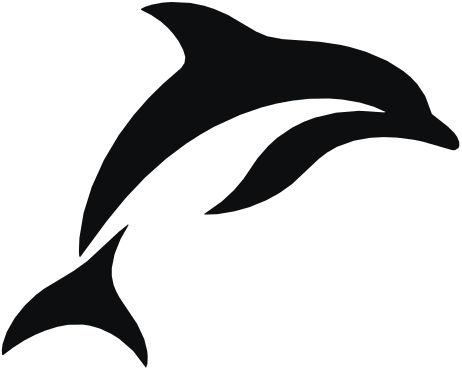
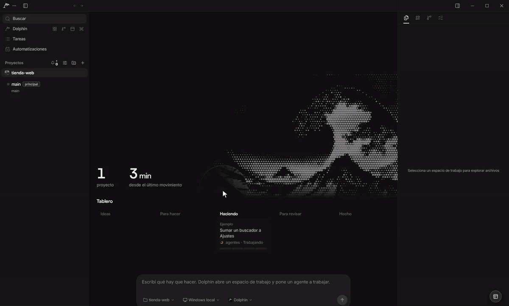
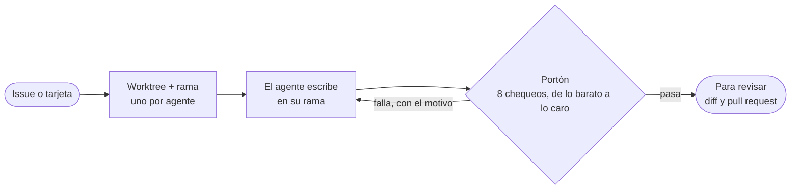
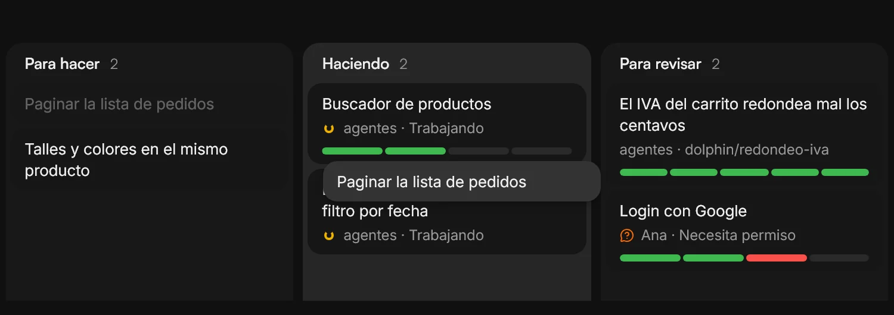
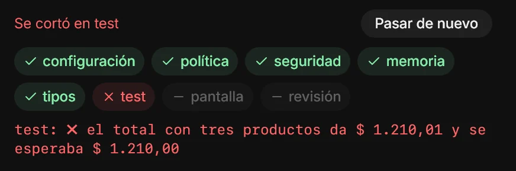

<p align="center">
  <picture>
    <source media="(prefers-color-scheme: dark)" srcset="ui/public/dolphin.svg">
    
  </picture>
</p>

<h1 align="center">Dolphin</h1>

<p align="center">
  Una app de escritorio y un CLI que corren Claude Code, Codex y otros agentes de código en paralelo,<br>
  cada uno en su rama, con tu propia suscripción.
</p>

<p align="center">
  <a href="https://github.com/Nicoo01x/dolphin-app/releases/latest"></a>
  <a href="LICENSE"></a>
  <a href="#descargar"></a>
</p>

<p align="center">
  <a href="https://odolphin.tech">Sitio</a> ·
  <a href="#descargar">Descargar</a> ·
  <a href="docs/porton.md">El portón</a> ·
  <a href="docs/motores.md">Agentes</a> ·
  <a href="CONTRIBUTING.md">Contribuir</a> ·
  <a href="README.md">Read in English</a>
</p>

<p align="center">
  <a href="https://odolphin.tech">
    
  </a>
</p>

## Qué hace

- **Cada tarea es una rama.** Elegís un issue de GitHub, tocás «Comenzar» y el agente que elegiste arranca en su propio worktree y su propia rama. Corren varios a la vez sin pisarse.
- **Un chat sobre el CLI del agente, con la terminal al lado.** Lo que escribís mientras el agente trabaja queda en una cola: lo mandás ya con «Enviar ahora» o lo borrás.
- **Un portón antes de la revisión.** Cada rama pasa por ocho chequeos, de lo más barato a lo más caro. Lo que falla vuelve al agente con el motivo exacto.
- **Un tablero de cinco columnas:** Ideas, Para hacer, Haciendo, Para revisar y Hecho. Soltar una tarjeta en Haciendo pone a trabajar a los agentes.
- **Un editor de código con el agente adentro.** Ctrl+K edita una selección en el lugar, la marca de git en el margen revierte un trozo, F12 te lleva a la definición con el servidor de TypeScript del proyecto y la búsqueda de archivos encuentra por nombre o por contenido.
- **Revisiones y puertos por espacio.** Cada espacio muestra su pull request, su issue y los puertos que tiene abiertos, y el pull request lo creás desde la app.

La app se actualiza sola desde las releases de GitHub. No hay cuenta ni servidor de Dolphin: lo que sale de tu máquina es lo que tus CLIs le mandan a su proveedor, y GitHub cuando lo usás.

## Descargar

| Sistema | Archivo |
|---|---|
| Windows 10 u 11 (x64) | [`dolphin-windows-setup.exe`](https://github.com/Nicoo01x/dolphin-app/releases/latest/download/dolphin-windows-setup.exe) |
| macOS 13.4 o más, Apple Silicon | [`dolphin-macos-arm64.dmg`](https://github.com/Nicoo01x/dolphin-app/releases/latest/download/dolphin-macos-arm64.dmg) |
| macOS 13.4 o más, Intel | [`dolphin-macos-x64.dmg`](https://github.com/Nicoo01x/dolphin-app/releases/latest/download/dolphin-macos-x64.dmg) |
| Linux x64 | [`dolphin-linux.AppImage`](https://github.com/Nicoo01x/dolphin-app/releases/latest/download/dolphin-linux.AppImage), o el `.deb` / `.rpm` de la [página de la versión](https://github.com/Nicoo01x/dolphin-app/releases/latest) |

Los instaladores todavía no están firmados, así que la primera vez hay un paso más:

- **Windows:** SmartScreen dice «Windows protegió su PC». Tocá **Más información** y después **Ejecutar de todas formas**.
- **macOS:** abrí la app una vez y andá a Ajustes del Sistema → Privacidad y seguridad → **Abrir igualmente**. Si dice que la app «está dañada», sacale la cuarentena de la descarga con `xattr -dr com.apple.quarantine "/Applications/Dolphin Code.app"`. Hasta que salga firmada, macOS te avisa de las versiones nuevas pero las bajás a mano.
- **Linux:** la primera vez, `chmod +x dolphin-linux.AppImage`.

También necesitás al menos un CLI de agente instalado y con sesión, como [Claude Code](https://claude.com/claude-code) o Codex.

## Agentes compatibles

Claude Code, Codex, Antigravity, Gemini CLI, OpenCode, GitHub Copilot CLI, Cursor, Droid, Amp y Qwen Code pueden trabajar en equipo. La app de escritorio abre más de 30 en su terminal, entre ellos Aider, Goose, Cline, Kiro y Continue. Dolphin corre el CLI que ya tenés, con tu sesión: no trae un modelo propio. Detalles y banderas: [docs/motores.md](docs/motores.md). La lista completa está en [el sitio](https://odolphin.tech/#agentes).

## Cómo funciona



1. **Tarea.** Arrancás desde un issue en Tareas o desde una tarjeta del tablero.
2. **Rama.** Dolphin le crea un worktree y una rama, así dos tareas nunca escriben en los mismos archivos.
3. **Portón.** Cuando el agente termina, la rama pasa por configuración, política, seguridad, memoria, tus scripts (tipos, tests, lint), pantalla, visión y revisión. Lo gratis corre primero; un modelo cobra recién al final. Lo que falla vuelve al agente con el motivo y el mismo chequeo se vuelve a correr. Más en [docs/porton.md](docs/porton.md).
4. **Revisión.** La rama llega a Para revisar. Leés el diff, abrís el pull request desde la app y lo integrás vos. Nada se escribe directo en tu rama.

<table>
  <tr>
    <td width="50%"></td>
    <td width="50%"></td>
  </tr>
</table>

## Compilar desde el código

Dolphin tiene dos partes: el núcleo (el CLI, la app de terminal y la consola web local) en la raíz del repo, y la app de escritorio en `escritorio/`.

**El núcleo.** Necesita Node 22.12 o más y git.

```bash
git clone https://github.com/Nicoo01x/dolphin-app.git
cd dolphin-app
npm install          # también construye la consola web
npm link             # deja el comando dolphin en el PATH
dolphin --demo       # el flujo entero con un agente de mentira: no gasta un token
```

**La app de escritorio.** Necesita Node 24 y pnpm 12.14.0.

```bash
cd escritorio
pnpm install
pnpm dev             # la app en modo desarrollo
pnpm build:win       # o build:mac / build:linux, para armar el instalador
```

Cómo se saca una versión está en [RELEASE.md](RELEASE.md), y cómo está armado, en [docs/arquitectura.md](docs/arquitectura.md).

## Contribuir

Sirven los reportes de bugs, los arreglos y los agentes nuevos. Sumar un agente de terminal suele ser una fila en [`src/agentes/motores.ts`](src/agentes/motores.ts). En [CONTRIBUTING.md](CONTRIBUTING.md) está cómo compilar, probar y abrir un pull request, y el [código de conducta](CODE_OF_CONDUCT.md) vale para todos. Para reportar una vulnerabilidad, leé [SECURITY.md](SECURITY.md).

## Licencia

[MIT](LICENSE). La app de escritorio, en `escritorio/`, lleva además su propio aviso MIT en [`escritorio/LICENSE`](escritorio/LICENSE), que viaja con cada copia.
