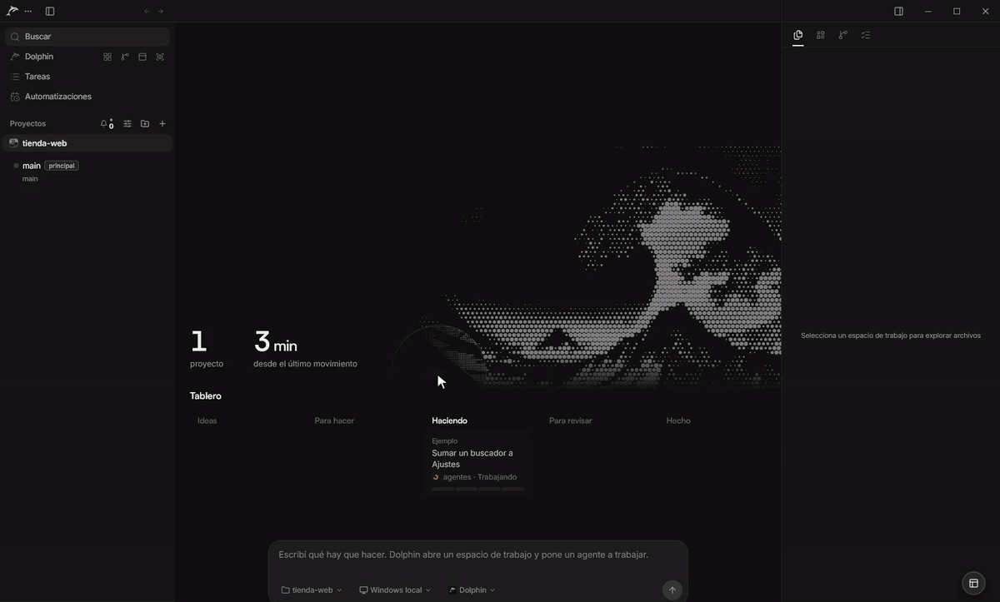
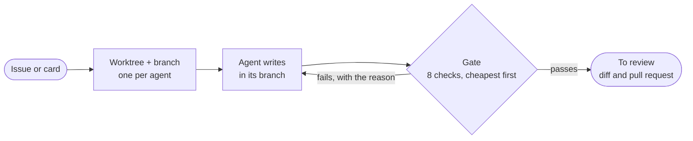
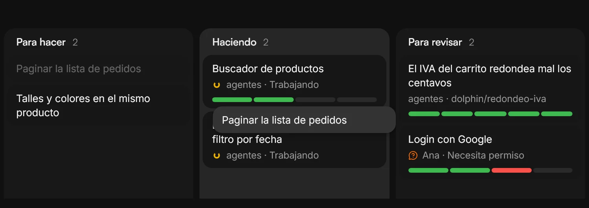
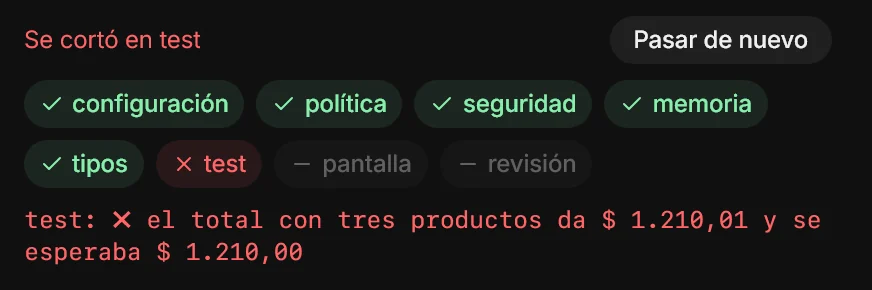

<p align="center">
  <picture>
    <source media="(prefers-color-scheme: dark)" srcset="ui/public/dolphin.svg">
    
  </picture>
</p>

<h1 align="center">Dolphin</h1>

<p align="center">
  A desktop app and CLI that runs Claude Code, Codex and other coding agents in parallel,<br>
  each on its own branch, with your own subscription.
</p>

<p align="center">
  <a href="https://github.com/Nicoo01x/dolphin-app/releases/latest"></a>
  <a href="LICENSE"></a>
  <a href="#download"></a>
</p>

<p align="center">
  <a href="https://odolphin.tech">Website</a> ·
  <a href="#download">Download</a> ·
  <a href="docs/porton.md">The gate</a> ·
  <a href="docs/motores.md">Agents</a> ·
  <a href="CONTRIBUTING.md">Contributing</a> ·
  <a href="README.es.md">Leer en español</a>
</p>

<p align="center">
  <a href="https://odolphin.tech">
    
  </a>
</p>

## What it does

- **Tasks become branches.** Pick a GitHub issue, press Start, and the agent you chose gets its own git worktree and branch. Several run at once without touching each other.
- **A chat on top of the agent's CLI, with a terminal next to it.** Messages you send while the agent is busy wait in a queue, where you can send one right away or delete it.
- **A gate before review.** Every branch goes through eight checks, cheapest first. A failure goes back to the agent with the exact reason.
- **A board with five columns:** Ideas, To do, Doing, To review, Done. Dropping a card into Doing starts the agents.
- **A code editor with the agent inside.** Ctrl+K edits a selection in place, the git gutter reverts a single hunk, F12 jumps to a definition through the project's TypeScript language server, and file search works by name or by content.
- **Reviews and ports per workspace.** Each workspace shows its pull request, its issue and the ports it has open, and you can create the pull request from the app.

The app updates itself from GitHub Releases. There is no Dolphin account and no Dolphin server: what leaves your machine is what your agent CLIs send to their own provider, plus GitHub when you use it.

## Download

| System | File |
|---|---|
| Windows 10 or 11 (x64) | [`dolphin-windows-setup.exe`](https://github.com/Nicoo01x/dolphin-app/releases/latest/download/dolphin-windows-setup.exe) |
| macOS 13.4+, Apple Silicon | [`dolphin-macos-arm64.dmg`](https://github.com/Nicoo01x/dolphin-app/releases/latest/download/dolphin-macos-arm64.dmg) |
| macOS 13.4+, Intel | [`dolphin-macos-x64.dmg`](https://github.com/Nicoo01x/dolphin-app/releases/latest/download/dolphin-macos-x64.dmg) |
| Linux x64 | [`dolphin-linux.AppImage`](https://github.com/Nicoo01x/dolphin-app/releases/latest/download/dolphin-linux.AppImage), or the `.deb` / `.rpm` on the [releases page](https://github.com/Nicoo01x/dolphin-app/releases/latest) |

The installers are not signed yet, so the first launch needs one extra step:

- **Windows:** SmartScreen says "Windows protected your PC". Click **More info**, then **Run anyway**.
- **macOS:** open the app once, then go to System Settings, Privacy & Security, and click **Open Anyway**. If macOS says the app is damaged, remove the download quarantine with `xattr -dr com.apple.quarantine "/Applications/Dolphin Code.app"`. Until the app is signed, macOS shows new versions but you download them by hand.
- **Linux:** run `chmod +x dolphin-linux.AppImage` the first time.

You also need at least one agent CLI installed and signed in, such as [Claude Code](https://claude.com/claude-code) or Codex.

## Supported agents

Claude Code, Codex, Antigravity, Gemini CLI, OpenCode, GitHub Copilot CLI, Cursor, Droid, Amp and Qwen Code can work as a team. The desktop app opens more than 30 others in its terminal, including Aider, Goose, Cline, Kiro and Continue. Dolphin runs the CLI you already have, with your session; it does not ship a model. Details and flags: [docs/motores.md](docs/motores.md). The full list is on [the website](https://odolphin.tech/#agentes).

## How it works



1. **Task.** You start from an issue in Tasks or a card on the board.
2. **Branch.** Dolphin creates a worktree and a branch for it, so two tasks never write to the same files.
3. **Gate.** When the agent finishes, the branch runs through configuration, policy, security, memory, your own scripts (types, tests, lint), screen, vision and review. The free checks run first; a model is only paid for at the end. Anything that fails goes back to the agent with the reason, and the same check runs again. More in [docs/porton.md](docs/porton.md).
4. **Review.** The branch lands in To review. You read the diff, open the pull request from the app and merge it yourself. Nothing is written to your branch directly.

<table>
  <tr>
    <td width="50%"></td>
    <td width="50%"></td>
  </tr>
</table>

## Build from source

Dolphin has two parts: the core (CLI, terminal app and local web console) at the repository root, and the desktop app in `escritorio/`.

**Core.** Requires Node 22.12 or later and git.

```bash
git clone https://github.com/Nicoo01x/dolphin-app.git
cd dolphin-app
npm install          # also builds the web console
npm link             # puts the dolphin command on your PATH
dolphin --demo       # the full flow with a fake agent: no tokens spent
```

**Desktop app.** Requires Node 24 and pnpm 12.14.0.

```bash
cd escritorio
pnpm install
pnpm dev             # run the app in development mode
pnpm build:win       # or build:mac / build:linux, to produce an installer
```

How a release is cut is in [RELEASE.md](RELEASE.md), and the architecture is in [docs/arquitectura.md](docs/arquitectura.md).

## Contributing

Bug reports, fixes and new agent integrations are welcome. Adding a terminal agent is usually one row in [`src/agentes/motores.ts`](src/agentes/motores.ts). Read [CONTRIBUTING.md](CONTRIBUTING.md) for how to build, test and open a pull request, and follow the [Code of Conduct](CODE_OF_CONDUCT.md). To report a vulnerability, see [SECURITY.md](SECURITY.md).

## License

[MIT](LICENSE). The desktop app in `escritorio/` carries its own MIT notice in [`escritorio/LICENSE`](escritorio/LICENSE), which ships with every copy.
