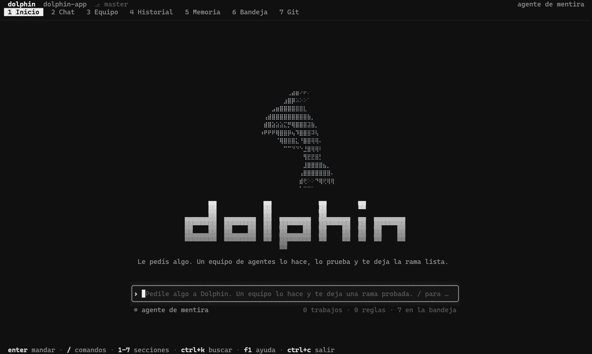
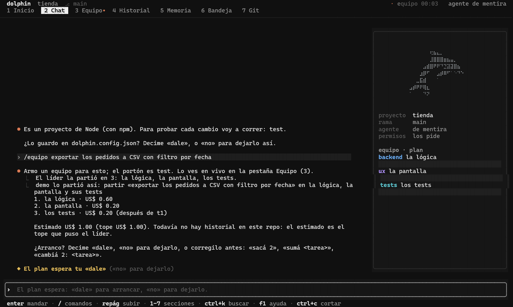
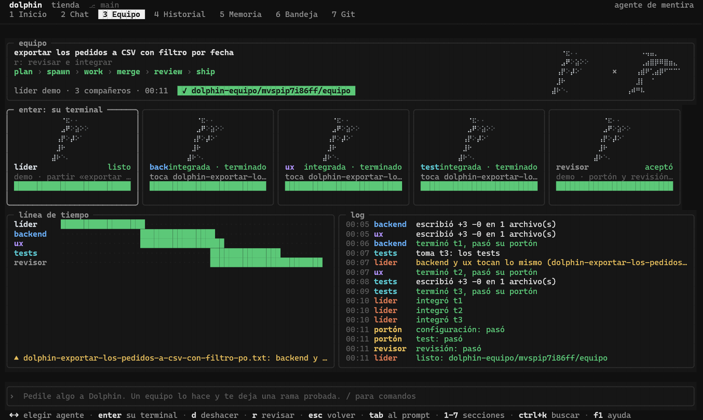
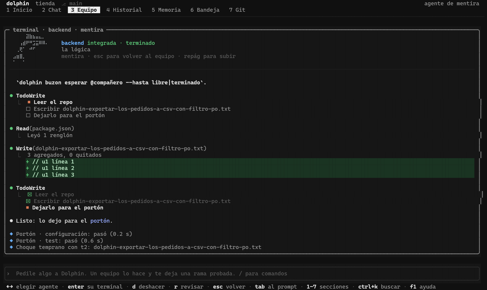
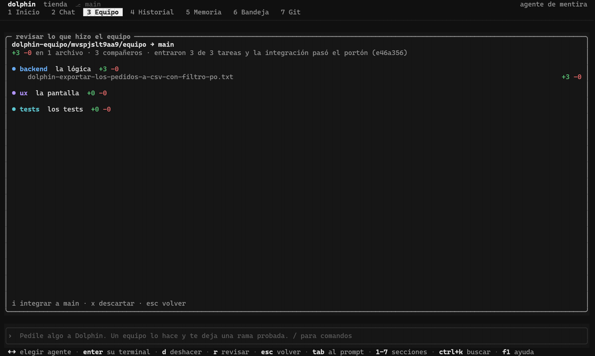
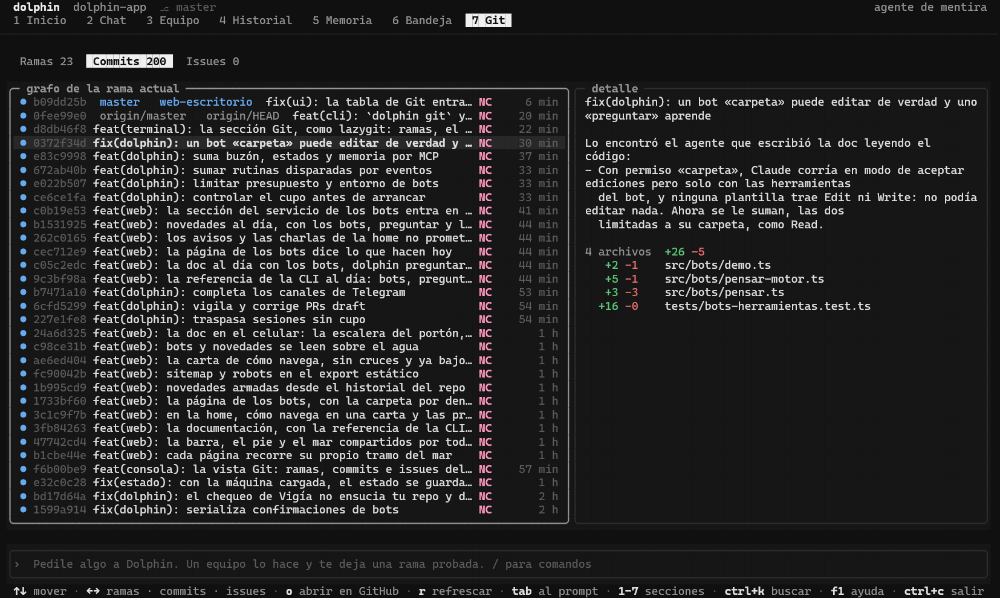

# La app de terminal

`dolphin` abre la app sobre el repo donde estás. Fuera de un repo te muestra tus proyectos para
elegir uno. Con `--demo` corre con el agente de mentira: se ve todo y no gasta nada.

```bash
dolphin                                 # sobre el repo donde estás
dolphin --repo "D:/mi-proyecto"         # sobre otro
dolphin --demo                          # sin gastar un token
dolphin --agente claude|codex|antigravity|mentira
dolphin --verificar typecheck,test      # el portón (por defecto: typecheck, lint y test si existen)
dolphin --dangerously-skip-permissions  # el agente no pide permisos; el portón y la política siguen
```

<p align="center">
  
</p>

## Las siete secciones

`1` Inicio · `2` Chat · `3` Equipo · `4` Historial · `5` Memoria · `6` Bandeja · `7` Git. Con el
prompt vacío, el número cambia de sección; `alt+número` anda siempre. `ctrl+k` busca secciones,
comandos y proyectos, y `f1` abre la ayuda.

## Le escribís como a un colega

Dolphin decide qué hacer con cada mensaje:

- un «hola» o una duda se contesta;
- un cambio chico lo hace un agente en una rama;
- un proyecto serio lo parte un líder en tareas, y antes te hace las preguntas que cambian el resultado.

Usa la memoria del proyecto y te dice qué reglas usó.

## Sabés cuánto cuesta antes de arrancar

<p align="center">
  
</p>

El modelo principal (el que elegís con `/lider`) parte el pedido en tareas. Dolphin estima cada una
con lo que costaron de verdad las ramas de tu repo y espera tu «dale». Antes lo podés corregir
escribiendo como a una persona: «sacá 2», «sumá documentar el CSV», «cambiá 3: tests con 10.000
filas». Si el peor caso pasa el tope del proyecto (`terminal.tope`), no arranca.

## Ves la orquestación

<p align="center">
  
</p>

Un cuadradito por agente —el líder, cada compañero, el revisor— con su mascota, que espera, trabaja,
festeja o se apaga según lo que pasa. La línea de tiempo muestra quién trabajó cuándo y el log, cada
paso: quién tomó qué tarea, qué escribió, qué fase del portón pasó. Si dos compañeros tocan el mismo
archivo, se avisa antes del merge.

Con `enter` entrás a la **terminal en vivo** de cualquiera: lo que lee, lo que edita, los comandos
que corre y lo que le contesta el portón.

<p align="center">
  
</p>

## Revisás por partes y deshacés por partes

- Con `r`, la rama del equipo aparece agrupada por compañero: qué archivos tocó cada uno y cuánto.
  Se integra a tu rama con `i` o se descarta con `x`.
- Con `d`, se deshace solo lo de un compañero (un `git revert` de su merge) y el portón vuelve a
  correr sobre lo que queda.

<p align="center">
  
</p>

## La sección Git

Las ramas con cuánto les falta integrar, su PR y el detalle de sus commits; el grafo de la rama
actual con el detalle de cada commit (mensaje entero y archivos); y los issues de GitHub (con `gh`).
Con `enter` se entra, como en lazygit: de una rama a sus commits (los propios arriba, lo que ya está
en la base apagado), de un commit a sus archivos con el diff del elegido al lado, y de un archivo a
su diff a pantalla completa; `esc` vuelve un paso. Un merge se lee contra su primer padre, así se ve
lo que trajo. `o` abre lo elegido en GitHub. Lo mismo, impreso, es `dolphin git [ramas|commits|issues]`.

<p align="center">
  
</p>

## Los comandos con barra

| Comando | Qué hace |
|---|---|
| escribir + enter | Dolphin decide: contesta, lo hace un agente o arma un equipo |
| `/equipo <tarea>` | arma el equipo directo |
| `/hacer <tarjeta>` | el equipo toma una tarjeta del tablero: con tu «dale» pasa a Haciendo y, si pasa el portón, a Para revisar con su rama; si no sale, vuelve a Para hacer con el porqué |
| `/objetivo <objetivo>` | lo persigue hasta lograrlo: reintenta con lo que falló, escala de modelo, instala lo que falte y te pide ayuda solo si se traba, con el tope del proyecto como límite |
| `/objetivo <objetivo> --oraculo <comando>` | lo mismo, pero lo juzga un comando tuyo: no está logrado hasta que salga en 0 sobre la rama del equipo. La evidencia de cada intento queda en `.dolphin/objetivos/` |
| `/lider opus` | el modelo principal, el que parte la tarea |
| `/memoria <regla>` · `/idea <idea>` | a la memoria del proyecto · a la bandeja |
| `/integrar` · `/descartar` · `/deshacer <compañero>` | lo mismo que `i`, `x` y `d` en la sección Equipo |
| `/turnos <compañero>` · `/volver <compañero> <n>` | cada turno de un compañero queda guardado en git; `/volver` lo lleva a ese turno dentro de la rama del equipo, sin tocar lo de los demás, y vuelve a pasar el portón |
| `/bug <qué pasa>` | primero una prueba que reproduce el bug y **falla hoy**; después el arreglo, que no está hecho hasta que la prueba pase |
| `/comparar <tarea>` · `/elegir <n>` | la misma tarea a varios motores a la vez; elegís mirando las apps lado a lado |
| `/noche <tarea>` · `/parte` · `/aprobar <n>` | para el turno de noche · el parte de la mañana · mergear una de sus tareas |
| `/programar [diario] 02:00 <tarea>` | la agenda que corren la consola y la app de escritorio |
| `/buscar <palabras>` | busca en todo lo que hablaste con Dolphin en el proyecto, en cualquier sesión |
| `/doctor` | busca lo que quedó roto (worktrees huérfanos, enlaces rotos, agentes colgados) y lo arregla |
| `/abrir <ruta>` | otro repo (queda en tus proyectos) |

## Te avisa donde estés

Si no estás mirando la terminal, te avisa cuando un trabajo termina, espera tu respuesta o pasa
cinco minutos sin novedades: una notificación del sistema y, con `DOLPHIN_TELEGRAM_TOKEN` y
`DOLPHIN_TELEGRAM_CHAT`, también Telegram.

## Desde el celular

`dolphin telegram` escucha a tu bot: lo que le escribís es lo mismo que escribir en la terminal (la
misma memoria, el mismo «dale») y la respuesta vuelve por el chat. Solo atiende al chat de
`DOLPHIN_TELEGRAM_CHAT`. Acepta archivos y fotos; las notas de voz se transcriben con un comando
local que configurás en `DOLPHIN_TRANSCRIBIR` (por ejemplo whisper.cpp).

```bash
DOLPHIN_TELEGRAM_TOKEN=<el de @BotFather> DOLPHIN_TELEGRAM_CHAT=<tu chat> dolphin telegram --repo "D:/mi-proyecto"
```

## Arranca en treinta segundos

La primera vez en un repo detecta qué es (Node, Python, Go, Rust), con qué se instala y qué hay para
probarlo, y propone el `dolphin.config.json`. Además trae las viñetas de tu `CLAUDE.md`/`AGENTS.md`
a la memoria, como reglas que esperan tu ok. No gasta un token.

Cada proyecto decide cómo trabaja la terminal:

```json
{
  "terminal": {
    "modo": "pensar",
    "modelo": "sonnet",
    "preguntar": true,
    "aprobarPlan": true,
    "tope": 5,
    "verificar": ["typecheck", "test"]
  },
  "porton": {
    "comandos": [{ "nombre": "test", "cmd": "python", "args": ["-m", "pytest", "-q"] }]
  }
}
```

`modo` puede ser `pensar` (por defecto), `equipo` (todo al equipo), `agente` (todo a un agente) o
`charla` (solo conversa). `tope` va en dólares y se compara con el peor caso del plan.
`porton.comandos` suma al portón lo que no es npm; un repo clonado de afuera no los corre.

Todo usa los mismos datos que la consola y la app de escritorio (`.dolphin/` en el repo y
`~/.dolphin`), así que podés usar cualquiera.

## Más allá de una tarea

**Mientras dormís.** `dolphin noche --hasta 07:00` toma lo que marcaste «para esta noche» en la
bandeja (y lo que le pases con `--tarea`) y lo hace de a una, cada tarea en su rama con el portón.
Si una cuenta se queda sin cupo pasa a la otra; si no queda ninguna, espera la ventana siguiente. A la
hora que dijiste no arranca nada más, y te deja el **parte de la mañana**: una tarjeta por tarea
(qué hizo, el portón, la rama, los videos). Lo decidís desde la terminal o el celular.

```bash
dolphin noche --tarea "que el carrito acepte cupones" --tarea "exportar pedidos a CSV" --hasta 07:00
```

**Elegí mirando, no leyendo diffs.** `dolphin comparar --tarea …` le da la misma tarea a Claude,
Codex y Antigravity a la vez (`--motores` elige quiénes), cada uno en su rama y con el portón, y arma
una página con las apps lado a lado: el video de cada una andando, si pasó, cuánto tocó y cuánto
costó.

**Del bug que viste al arreglo.** `dolphin bug --que …` hace las cosas en el orden que las vuelve
confiables: una prueba que reproduce el bug y falla hoy (si no falla, no lo reprodujo y no lo arregla
a ciegas), y después el arreglo encima. Hasta tres intentos, cada uno con lo que imprimió la prueba
como pista.

**Migrar con paridad.** `dolphin paridad grabar` le pregunta a la app vieja por cada ruta y guarda lo
que contesta; `dolphin paridad comprobar` levanta la nueva y sale en 0 solo si contesta igual, así que
sirve de oráculo para `/objetivo`.

```bash
dolphin paridad grabar --url http://localhost:3000 --ruta / --ruta /api/pedidos --ignorar fecha,id
# en la terminal de dolphin:
/objetivo pasar el backend de Express a Fastify --oraculo dolphin paridad comprobar --grabacion "<lo que imprimió grabar>" --levantar "npm start -- --port {PUERTO}"
```

**La bitácora compartida.** `dolphin bitacora exportar` deja las reglas y los errores confirmados del
proyecto con su patrón y **sin nada del proyecto** (ni rutas, ni URLs, ni correos, ni claves, ni el
nombre del repo), etiquetados por framework (`next@16`, `prisma@6`). `dolphin bitacora importar
<archivo o URL>` trae las de otro como candidatas: no se usan hasta que les das el visto bueno.

**Cuando algo se cortó a mitad de camino.** `dolphin doctor` (o `/doctor`) busca worktrees que dejó un
Dolphin que ya no corre, ramas de Dolphin ya integradas, `node_modules` enlazados a nada, asuntos de
la bandeja «implementando» sin nadie y agentes que siguen corriendo sobre un worktree que ya no
existe. Solo toca lo que creó Dolphin. Corre solo al abrir un proyecto; `--solo-mirar` no toca nada.
