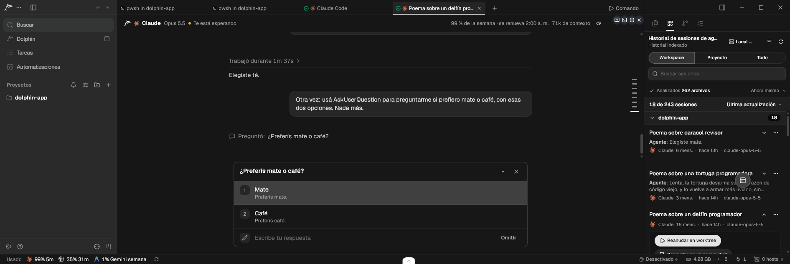
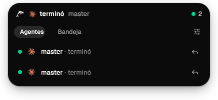
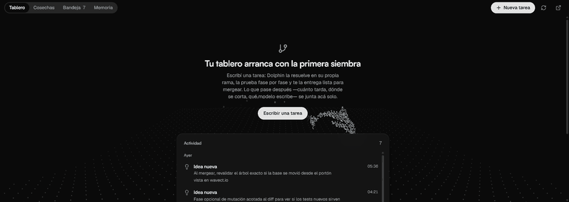

# Dolphin

**La app para trabajar con agentes de código.** Abrís Claude Code, Codex o el CLI que uses y no
ves una terminal: ves un chat con lo que el CLI no te muestra —con qué modelo responde, cuánto
contexto lleva, cuánto del plan te queda, qué archivos tocó— y el CLI de verdad sigue corriendo
abajo, con toda su potencia.



## Qué tiene

- **El chat sobre el CLI.** Cada agente abre en una vista de chat con el CLI interactivo debajo
  (no `claude -p`, que tiene menos potencia). Arriba, una barra con el modelo, en qué anda
  («Trabajando», «Te está esperando»), la ventana del plan que más se gastó y el contexto.
- **Los archivos al costado.** Lo que el agente escribe se abre a la derecha en modo cambios,
  sin robarte el foco, como en un editor.
- **Insignias en lo que escribe el agente.** Números, tamaños y modelos resaltados con color
  para leer un reporte de un vistazo (nunca adentro del código).
- **La isla.** Una pastilla arriba de la pantalla, encima de cualquier app, que dice qué agente
  te necesita o terminó. Se abre con Agentes, Bandeja y Notas; le respondés a un agente desde
  ahí sin cambiar de ventana, la movés adonde quieras y avisa sola.
- **Dictado local.** El micrófono baja un modelo de voz que corre en tu compu.
- **La consola de Dolphin.** Tareas que se resuelven en su propia rama y se prueban fase por
  fase antes de dártelas; una memoria del proyecto que hace que no tengas que repetir las cosas
  (vale para cualquier modelo, no para uno solo); y una bandeja de ideas y errores que Dolphin
  encuentra solo.

<p>
  
</p>



## Presencia en Discord

Dolphin puede publicar en qué proyecto y con qué lenguaje estás trabajando. Está apagada hasta que
exista una aplicación de Discord propia: el nombre y el ícono que ve la gente los da esa
aplicación, y sin una, Dolphin aparecería con el nombre de otra.

Para prenderla, en [discord.com/developers/applications](https://discord.com/developers/applications)
→ **New Application**, y el **Application ID** va en la variable de entorno
`DOLPHIN_DISCORD_APP_ID` (o fijo en `DOLPHIN_DISCORD_APP_ID` de `src/shared/dolphin-brand.ts`).
Nada más: sin ese id no se abre ningún socket.

Lo que sale: el nombre del proyecto y el lenguaje con el archivo (`TypeScript · motor.ts`), por el
IPC local de Discord. La ruta del archivo **no** se manda, solo su nombre.
`DOLPHIN_DISCORD_DEBUG=1` muestra por qué no conecta.

## Instalarla

Los instaladores de Windows, macOS y Linux están en
[Releases](https://github.com/Nicoo01x/dolphin-app/releases/latest), y la app se actualiza sola
desde ahí (en macOS, mientras salga sin firma, avisa y lleva a bajar el `.dmg` nuevo). Cómo
abrirlos sin firma y cómo se saca una versión: [RELEASE.md](../RELEASE.md).

## Correrla desde el código

```sh
pnpm install
pnpm dev
```

Se corre desde esta carpeta (`escritorio/`). El núcleo de la consola es la raíz de este mismo repo:
la app lo busca en la carpeta de arriba, o donde diga `DOLPHIN_APP_DIR`.

## Antes de commitear

```sh
pnpm typecheck
pnpm lint
pnpm exec vitest run --config config/vitest.config.ts <carpeta>
```

El formateador es `oxfmt` y el pre-commit lo corre solo.

## Licencia

MIT. El aviso está en [LICENSE](LICENSE) y tiene que quedar en el repo y en lo que se distribuya.
